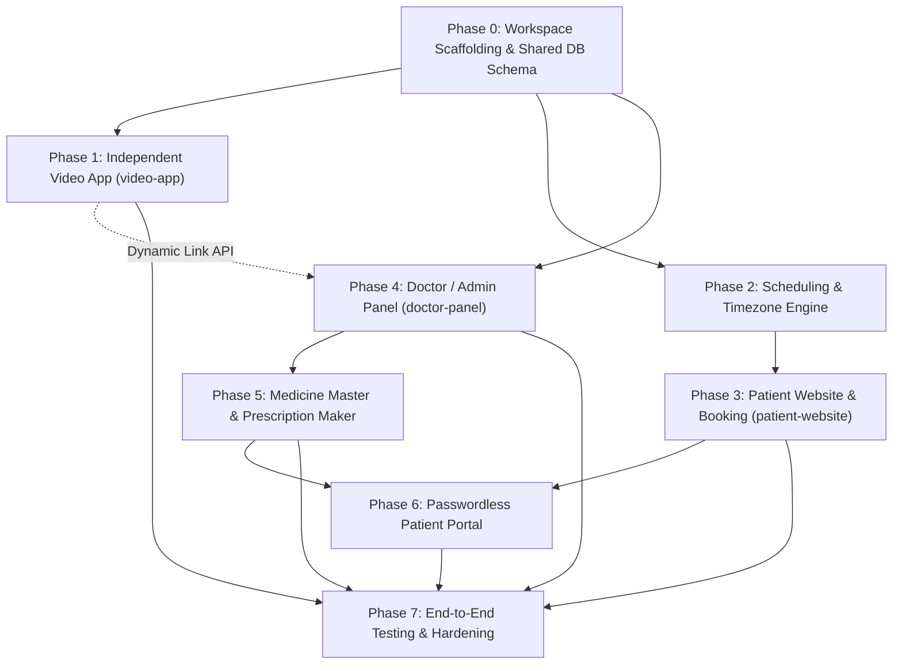

# Project Delivery Phases & Implementation Roadmap

**Product:** International Online Homeopathy Consultation Platform  
**Language:** Pure JavaScript (ES Modules, .js, .jsx) across all frontends and backends.  
**Architecture:** Three Dedicated Top-Level Folders (`patient-website`, `doctor-panel`, `video-app`), each containing decoupled `frontend/` and `backend/`.  
**Database Model:** Supabase PostgreSQL shared by `patient-website` and `doctor-panel` via `@kale/database` (`file:../../packages/database`). `video-app` is completely independent.  
**Dependency Model:** Decoupled independent `node_modules` per sub-directory (no root npm workspaces).  
**Environment Model:** Isolated per-project `.env` in each folder (no root `.env` requirement).  
**Prescription Storage:** Cloudflare R2 (10 GB free forever, zero egress fee, S3-compatible JS SDK).  
**Email Engine:** Automated Dual Failover (Primary: Gmail SMTP for 500 free/day & phone replies $\rightarrow$ Secondary: Resend for automatic failover when limits are reached).  
**Theme Support:** Universal Light Mode, Dark Mode, and System Theme Switcher across all three frontends.  
**Created:** 2026-11-07 09:05 IST  
**Updated:** 2026-11-08 14:05 IST  

---

## 1. Architectural Layout & Folder Structure

```text
Kale-Clinic-Website/
├── patient-website/                  # Folder 1: Patient Website & Portal
│   ├── frontend/                     # Next.js / React (Public site, booking UI, patient portal, theme switcher)
│   └── backend/                      # Node / Express / NestJS API (Patient booking, slots, payments, OTP auth)
│
├── doctor-panel/                     # Folder 2: Doctor & Admin Dashboard
│   ├── frontend/                     # Next.js / React (Dashboard, fee mgmt, prescription maker, patient DB, theme switcher)
│   └── backend/                      # Node / Express / NestJS API (Admin auth, prescriptions, fees, dynamic link dispatch)
│                                     # * SHARES SAME POSTGRESQL DATABASE AS PATIENT-WEBSITE *
│
├── video-app/                        # Folder 3: Completely Independent Video Calling App
│   ├── frontend/                     # WebRTC Video App (Cam/mic, screen share, settings, whiteboard, notes, theme switcher)
│   └── backend/                      # Signaling server, room lifecycle & dynamic link generation API (Independent)
│
├── project_context/                  # Central documentation and specifications
│   ├── PRD.md
│   ├── architecture.md
│   ├── design.md
│   ├── rules.md
│   ├── Security.md
│   ├── memory.md
│   └── phases.md
│
├── .env.example
└── README.md
```

---

## 2. Phase-by-Phase Implementation Roadmap

### Phase 0: Repository Scaffolding & Shared Database Foundation
**Goal:** Establish the workspace structure, shared database schemas, and global toolchains.

- [x] **Directory Layout Setup**:
  - Initialized the three designated folders: `patient-website/`, `doctor-panel/`, and `video-app/`.
  - Established `frontend/` and `backend/` sub-directories within each folder in pure JavaScript.
- [x] **Shared Database Architecture (`PostgreSQL`)**:
  - Configured shared PostgreSQL database schema (`packages/database/prisma/schema.prisma`) portable via standard `DATABASE_URL` (compatible with Supabase, AWS RDS, Neon, Docker).
  - Defined unified models for: `users`, `patients`, `doctor_profile`, `availability_rules`, `consultation_fee_rules`, `appointments`, `payments`, `consultations`, `medicines`, `prescriptions`, `video_sessions`, `passwordless_tokens`, and `audit_logs`.
- [x] **Global Theme Tokens & Base Configuration**:
  - Implemented CSS variables and Tailwind styling for Light Mode, Dark Mode, and System preference.
  - Implemented zero-FOUC `ThemeSwitcher` in `patient-website/frontend`, `doctor-panel/frontend`, and `video-app/frontend`.
- [x] **Failover Email & Cloudflare R2 Services Foundation**:
  - Automated Dual Failover Email Engine (Gmail SMTP $\rightarrow$ Resend rollover).
  - Cloudflare R2 storage service using S3-compatible JavaScript SDK (`@aws-sdk/client-s3`).

---

### Phase 1: Independent Video Calling Application (`video-app`) — **[COMPLETED & VERIFIED]**
**Goal:** Build a fully independent, standalone video calling platform with dynamic link generation, interactive whiteboard, and in-call note taker.

- [x] **`video-app/backend`**:
  - Independent WebRTC signaling server via Socket.io for peer-to-peer audio, video, and screen sharing.
  - Dynamic link generation API endpoint (`POST /api/rooms`) accepting external creation requests with cryptographically secure tokens.
  - Dynamic token validation endpoint (`GET /api/rooms/:roomId/validate`).
  - Webhook/callback dispatcher to notify clinic backend upon call termination (`notifyClinicSessionEnded` with start/end time and duration seconds).
  - Strict zero-recording enforcement (no media persistence or audio/video recording buffers).
  - Room-level `activePresentation` tracking to synchronize screen presentation feeds for late-joining participants.
- [x] **`video-app/frontend`**:
  - Standalone video calling interface with clean participant view and picture-in-picture local preview.
  - Universal Theme Switcher (Light / Dark / System mode toggle with zero-FOUC).
  - Media controls: Screen share toggle, Microphone mute/unmute, Camera on/off, End call.
  - Settings modal: Audio/video device selection (microphone, camera, speaker) and connection quality reassurance.
  - **Drawing Canvas (Whiteboard)**: Interactive collaborative canvas with freehand brush, color palette, eraser, clear canvas, 16:9 aspect ratio locking, real-time Socket.io stroke synchronization, and Doctor `"Share to Patient"` auto-drawer triggering.
  - **Note Taker**: In-call text editor with local autosave, character counter, clipboard copy, and `.txt` file export.
  - **Multi-Peer Responsive Alignment**: Dynamic Google Meet-style layout adapting for 1, 2, 3, 4, 5+ peers with initials avatars, mic mute pills, and name tags.
  - **Pinned Presentation Stage**: Automatic full-stage pinning of shared screens (`object-contain`) with zero edge cutoff.
  - **Mobile Presentation Dual Modes**:
    - **Case 1 (Whiteboard OPEN + Presentation ON)**: Cam feeds hidden on mobile to maximize whiteboard & presentation; Google Meet member count circle displayed in bottom-right corner.
    - **Case 2 (Whiteboard CLOSED + Presentation ON)**: Horizontal scrollable carousel of cam tiles (`h-20 sm:h-24 overflow-x-auto`) directly below the shared screen.
  - **Late Joiner Screen Share Sync**: Immediate WebRTC renegotiation on join ensures late arrivals instantly see active screen shares.
  - Dynamic link entry handling: Validates room token and role from URL parameters on join (`/room/:roomId?token=...&role=...`).
  - Codebase cleanup: Pure JavaScript/JSX, extracted reusable teardown helpers, removed redundant props and dead code. Next.js build verification exit code 0.

---

### Phase 2: Doctor Scheduling & Timezone Engine (Shared Backend)
**Goal:** Implement doctor availability in IST with dynamic conversion to patient-selected timezones.

- [ ] **Doctor Availability Configuration in IST (`Asia/Kolkata`)**:
  - Initial requested hours: 9:00 AM – 12:00 PM IST.
  - Support configurable working days, slot lengths (30 mins baseline), buffers, and blocked dates.
- [ ] **Timezone Engine**:
  - Maintain dynamic country-to-IANA-timezone mapping.
  - Calculate available slot instants server-side using maintained timezone library (`Luxon` / `date-fns-tz`).
  - Render dual display: Patient-local time alongside doctor's IST time.
- [ ] **Slot Hold & Concurrency Control**:
  - Temporary hold mechanism (10-minute configurable hold during checkout).
  - Database transactions with pessimistic/optimistic locking to eliminate double bookings.
  - Automatic expiration and cleanup of stale holds.

---

### Phase 3: Patient Website & Guest Booking (`patient-website`)
**Goal:** Deliver responsive public pages, guest appointment booking, payment checkout, and booking confirmation.

- [ ] **`patient-website/frontend`**:
  - Public pages: Home, About Doctor, Qualifications & Registration details, Consultation fees & process, FAQ, Contact, Privacy, Terms, Consent disclaimer.
  - Universal Theme Switcher (Light / Dark / System) in top navigation.
  - Guest booking interface (no compulsory password registration):
    - Country & dynamic timezone selection.
    - Slot calendar with dual patient-time / IST time display.
    - Minimal patient intake form: Name, DOB/age, gender, email, phone with country code, chief complaint.
    - Terms and telemedicine consent acknowledgements.
- [ ] **`patient-website/backend`**:
  - Slot availability query API.
  - Booking hold reservation endpoint.
  - Payment gateway order creation (INR 150 configurable baseline; snapshot price and currency).
  - Server-side payment webhook handler:
    - Cryptographic signature verification.
    - Idempotency protection against duplicate webhook events.
    - Transactional state transition from `held` / `pending_payment` to `confirmed`.
  - Email notification dispatch via Dual Failover Engine (Primary: Gmail SMTP, Secondary: Resend): Send booking confirmation, calendar details (patient time + IST), and dynamic video consultation link.

---

### Phase 4: Doctor & Admin Dashboard (`doctor-panel`)
**Goal:** Provide the doctor with practice management tools connected to the shared PostgreSQL database.

- [ ] **`doctor-panel/frontend`**:
  - Doctor authenticated shell with responsive sidebar.
  - Universal Theme Switcher (Light / Dark / System mode toggle).
  - **Fee Management Module**:
    - Configure India consultation fee (INR 150 baseline).
    - Configure international consultation fees and currencies.
    - Set separate rates for initial consultations vs. follow-ups.
  - **Patient Database Module**:
    - Searchable directory of all registered/guest patients.
    - Patient clinical profiles: demographic details, history of complaints, past appointments, prescription archives, and call logs.
  - **Appointments & Calendar Management**:
    - Overview of today's schedule, upcoming consultations, and past visits.
    - Slot status badges: `Confirmed`, `Pending Payment`, `Completed`, `Cancelled`, `No-show`.
    - Reschedule and cancellation actions.
  - **Dynamic Video Link Generation & Launch**:
    - "Generate Consultation Link" action for confirmed appointments (calls `video-app/backend` link generation API).
    - "Join Video Call" direct action opening the independent video room with doctor credentials.
  - **Consultation Workspace**:
    - Active patient card with previous history summary.
    - Clinical notes editor (chief complaint, present illness, clinical observations, provisional diagnosis, advice).
    - Internal doctor notes (strictly private, hidden from patient portal).
    - Optional vitals intake (BP, pulse, SpO2, temp, glucose, height, weight; missing values show `—`).
    - Follow-up date scheduler.

---

### Phase 5: Medicine Master, Prescription Maker & Digital PDF
**Goal:** Empower the doctor to curate medicines, build structured prescriptions, and issue immutable PDFs.

- [ ] **Medicine Master Catalogue**:
  - Starts empty; managed exclusively by the doctor.
  - CRUD operations: Medicine name, category, potency, form (tablet, dilution, globules, drops), strength, default dosage, notes.
- [ ] **Structured Prescription Builder**:
  - Searchable medicine lookup from master with option to add custom one-off medicines.
  - Prescription item rows: Medicine, potency, form, dosage quantity, frequency, meal timing (before food, after food, etc.), duration, instructions.
  - Reorder, duplicate, and remove medicine rows.
  - Live draft preview with doctor/clinic header and disclaimer.
- [ ] **Finalization & Immutable PDF Generation**:
  - Doctor explicit finalization action (locks prescription; amendments create new versions).
  - Server-side printable PDF renderer using finalized snapshot (not mutable master).
  - Private object storage upload to **Cloudflare R2** (10 GB free forever, zero bandwidth/egress fees, using `@aws-sdk/client-s3`).
  - Automated secure email dispatch with prescription PDF / portal download link via Failover Email Engine.

---

### Phase 6: Passwordless Patient Portal (`patient-website`)
**Goal:** Allow patients to securely access their medical records without passwords.

- [ ] **Passwordless Authentication Flow**:
  - Patient enters email used during booking.
  - Backend issues cryptographically secure, short-lived single-use OTP or magic link.
  - Rate limiting, brute-force protection, and enumeration defense.
- [ ] **Patient Records Dashboard**:
  - View upcoming and previous consultations.
  - Review appointment date/time (in patient timezone), doctor notes (patient-visible advice only), and call duration metadata.
  - Download verified, finalized prescription PDFs via authenticated short-lived signed URLs.
  - Strict Object-Level Authorization (IDOR prevention): Patient A can never access Patient B's records.

---

### Phase 7: Quality Assurance, Security Hardening & Launch Readiness
**Goal:** End-to-end testing, compliance verification, and deployment.

- [ ] **Theme Switching Verification**:
  - Verify Light, Dark, and System modes across all 3 frontends (`patient-website`, `doctor-panel`, `video-app`).
  - Ensure zero theme flash (FOUC) and WCAG 2.2 AA contrast compliance in all modes.
- [ ] **Critical Security & Concurrency Tests**:
  - Concurrent booking race-condition tests (verify zero double-bookings).
  - Hold expiry automated background worker test.
  - Payment webhook replay and signature forgery tests.
  - Role-based isolation: ensure patient session cannot query doctor/admin endpoints or direct database tables.
  - Verification that internal doctor notes never leak into patient API responses or PDFs.
  - Dynamic video link expiration and isolation tests.
  - Verification that call recording remains strictly disabled.
- [ ] **Deployment & Operations**:
  - Environment variables auditing across all 3 projects (`.env.example`).
  - Production database backups, migration verification, and SSL/TLS configuration.

---

## 3. Phase Dependency Graph



---

## 4. Acceptance Checklists per Phase

| Phase | Core Deliverable | Key Acceptance Criteria |
|---|---|---|
| **0** | Workspace & Shared DB | 3 top-level folders created with `frontend/` & `backend/`; PostgreSQL schema migrations ready. |
| **1** | Independent `video-app` | Standalone WebRTC video app with screen share, cam, mute, settings, whiteboard, notes, dynamic link API, and theme switcher. |
| **2** | Scheduling & Timezone | 9 AM – 12 PM IST availability, IANA timezone conversion, transactional slot reservation with 10-minute hold expiry. |
| **3** | Patient `patient-website` | Guest booking, payment checkout, webhook verification, confirmation email with dynamic meeting link, theme switcher. |
| **4** | Doctor `doctor-panel` | Connected to shared DB; fee management, patient database, appointment calendar, video link generation, consultation notes. |
| **5** | Prescriptions & PDF | Empty medicine master, custom rows, live preview, versioned finalization, printable PDF generation, private storage. |
| **6** | Patient Portal | Email OTP / magic link login, prescription PDF download, consultation history, internal notes private. |
| **7** | QA & Security | Zero double-bookings, dark/light theme verified everywhere, unrecorded calls confirmed, IDOR tests pass. |

